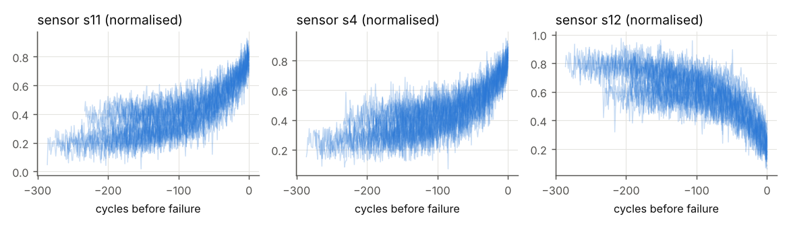
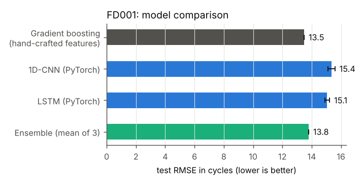
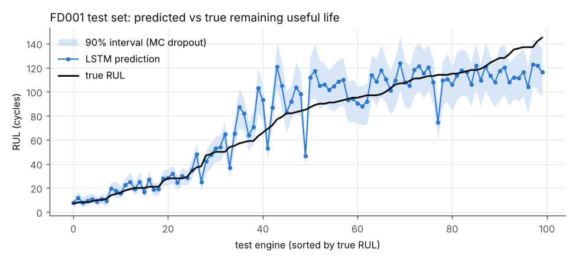
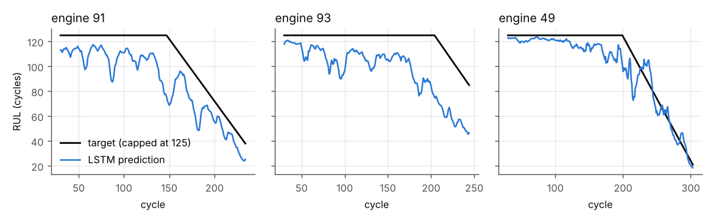

# Predictive maintenance of turbofan engines: RUL prediction, uncertainty and maintenance decisions


  

**Key result:** using the predicted *uncertainty* (not just the predicted RUL) to decide maintenance cuts the
total cost by 36 % on the 100 NASA test engines (29 vs 45) and misses 1 failure instead of 3.

**Question.** From the sensor history of an aircraft engine, how many flight cycles remain before failure
(Remaining Useful Life, RUL)? And, more importantly for an airline, **when should the engine go to maintenance?**

Dataset: **NASA C-MAPSS FD001** (Saxena et al., 2008): 100 engines run to failure for training, 100 engines
stopped before failure for testing, 21 sensors, one operating condition.

## Pipeline

```
raw sensors ─► drop 7 constant sensors ─► min-max scaling (fitted on train engines only)
            ─► sliding windows of 30 cycles ─► models ─► RUL prediction
                                                   ├─► uncertainty (MC dropout, conformal prediction)
                                                   ├─► maintenance decision (expected cost)
                                                   └─► interpretable diagnosis (Bayesian network)
```

* **Target:** piecewise-linear RUL capped at 125 cycles (a new engine shows no measurable wear).
* **No leakage:** validation engines are held out *per engine* (20 %), never per row.
* **Official protocol:** one prediction per test engine (its last cycle), compared with the true RUL given by NASA.



## Results (FD001 test set, 100 engines)

| Model | RMSE (cycles) ↓ | PHM08 score ↓ | Train time (CPU) |
|---|---:|---:|---:|
| Gradient boosting on hand-crafted window features | **13.49** | **237** | 4 s |
| 1D-CNN (PyTorch) | 15.36 ± 0.23 | 414 ± 40 | 78 s / seed |
| LSTM (PyTorch) | 15.06 ± 0.17 | 410 ± 9 | 199 s / seed |
| Ensemble (mean of the three) | 13.80 | 284 | – |

Deep models: mean ± std over 3 seeds. RMSE is computed against the **true, uncapped** test RUL (stricter than
the capped target used by many papers). PHM08 score penalises late predictions more than early ones.



**Honest finding:** on FD001 (a single operating condition and ~14 k training windows), a gradient-boosting model
on well-chosen features (last value, mean, std and slope of each sensor over the window) beats both neural networks.
A first CNN with global average pooling reached ~20 RMSE; keeping the time positions (flatten instead of pooling)
brought it to 15.4. The deep models remain useful here because they give an uncertainty estimate (below).



### Uncertainty: is the 90 % interval really 90 %?

| Method | Coverage of the true RUL (target 90 %) | Mean width |
|---|---:|---:|
| MC dropout (200 stochastic passes, LSTM) | 74 % | 28 cycles |
| Split conformal prediction (calibrated on validation engines) | **87 %** | 47 cycles |

MC dropout is **over-confident** (a known weakness). Conformal calibration gives intervals that are wider but much
closer to the promised coverage, without any assumption on the model.

### From prediction to decision

At its last observed cycle, each test engine is either sent to maintenance (cost 1) or kept flying 20 more
cycles (cost 10 if it fails meanwhile). The Bayes-optimal rule is: maintain if P(RUL ≤ 20) ≥ 1/10.

| Policy | Total cost ↓ | Missed failures | Unnecessary maintenances |
|---|---:|---:|---:|
| Never maintain | 160 | 16 | 0 |
| Always maintain | 100 | 0 | 84 |
| Point prediction (maintain if predicted RUL ≤ 20) | 45 | 3 | 2 |
| **Uncertainty-aware** (P(fail) from MC-dropout samples) | **29** | **1** | 4 |
| Oracle (knows the true RUL) | 16 | 0 | 0 |

Using the predictive distribution instead of a single number **cuts the cost by 36 %** and misses 1 failure instead
of 3: the value of uncertainty is in the decision, not only in the RMSE.

### Interpretable diagnosis with a Bayesian network (pyAgrum)

Health state from the true RUL: *critical* (≤ 30), *degrading* (≤ 90), *healthy*. The 6 sensors most correlated with
the RUL (s11, s4, s12, s7, s15, s21) are smoothed and discretised (low / mid / high). Structure learned by greedy
hill climbing (BIC score), with the constraint that `health` is a root cause.

* Exact inference: with no evidence P(critical) = 0.15; observing **s11 = high and s4 = high** raises it to **0.49**.
  An engineer can read why, and the network still works when sensors are missing.
* Accuracy on the test engines: 67 % (macro-F1 0.58), versus 85 % (macro-F1 0.84) when the LSTM's RUL is turned into a
  health state. The network trades accuracy for interpretability and robustness to missing data.



## Run it

```bash
pip install -r requirements.txt
python -m pytest -q tests                              # 9 unit tests on synthetic data, ~2 s
python run_experiments.py --subset FD001 --seeds 0 1 2 # downloads the data, ~15 min on a laptop CPU
```
Every number above is written to `results/metrics_FD001.json` and every figure to `figures/`.

## Code structure

| File | Content |
|---|---|
| `rul/data.py` | loading, RUL labels, sensor selection, scaling, windows, engine-wise split |
| `rul/features.py` | window features for the gradient-boosting baseline |
| `rul/models.py` | 1D-CNN and LSTM in PyTorch, Monte-Carlo dropout |
| `rul/train.py` | training loop, early stopping, learning-rate schedule |
| `rul/metrics.py` | RMSE, PHM08 score, interval coverage, split conformal |
| `rul/decision.py` | cost-based maintenance policies |
| `rul/bayes.py` | Bayesian network learning and inference (pyAgrum) |

## Limits and next steps

FD001 only (one operating condition): FD002/FD004 need normalisation per operating regime. 3 seeds is a small sample.
Next: per-regime normalisation, conformalised quantile regression, and an influence diagram that integrates the
decision directly in the probabilistic model.

## References

* Saxena, Goebel, Simon, Eklund, *Damage propagation modeling for aircraft engine run-to-failure simulation*, PHM 2008.
* Li, Ding, Sun, *Remaining useful life estimation in prognostics using deep convolution neural networks*, RESS 2018.
* Gal & Ghahramani, *Dropout as a Bayesian approximation*, ICML 2016.
* Angelopoulos & Bates, *A gentle introduction to conformal prediction and distribution-free uncertainty quantification*, 2021.
* Ducamp, Gonzales, Wuillemin, *aGrUM/pyAgrum: a toolbox to build models and algorithms for probabilistic graphical models in Python*, PGM 2020.

---
Author: **Gaya Lahouazi**, M2 AI2D (Sorbonne Université). Links with the MADI course (decision under uncertainty).
